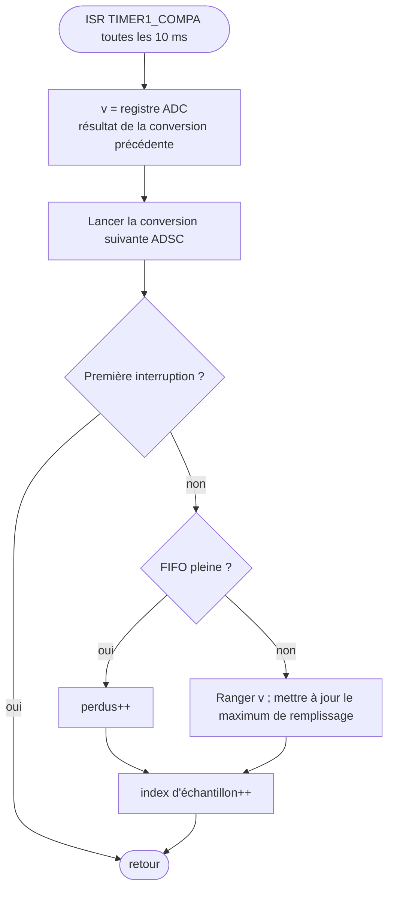
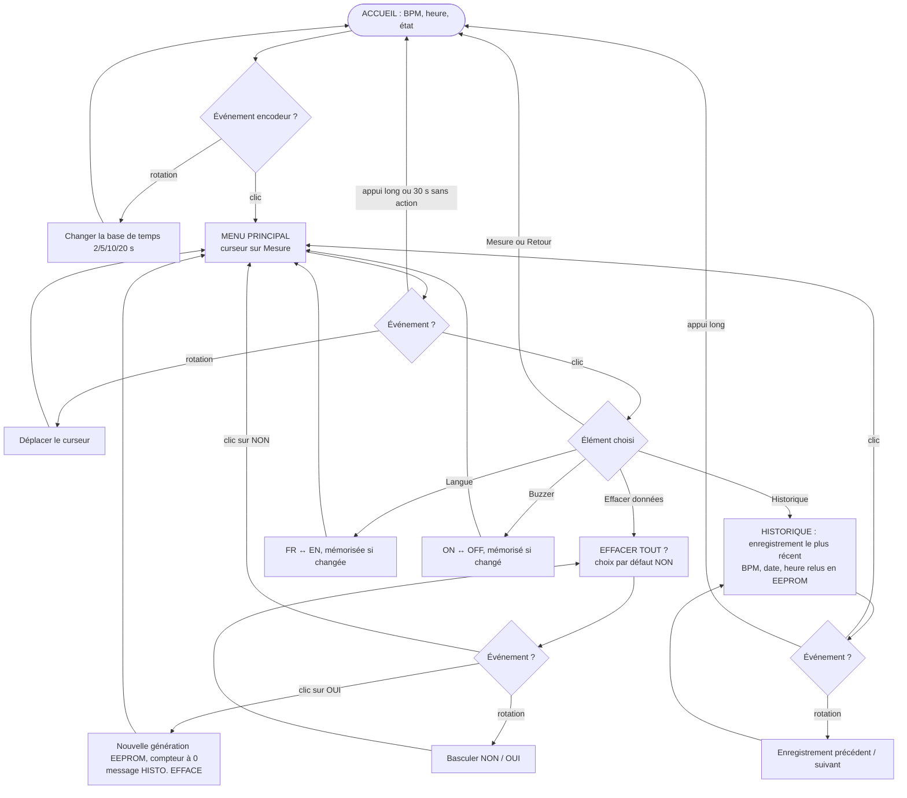
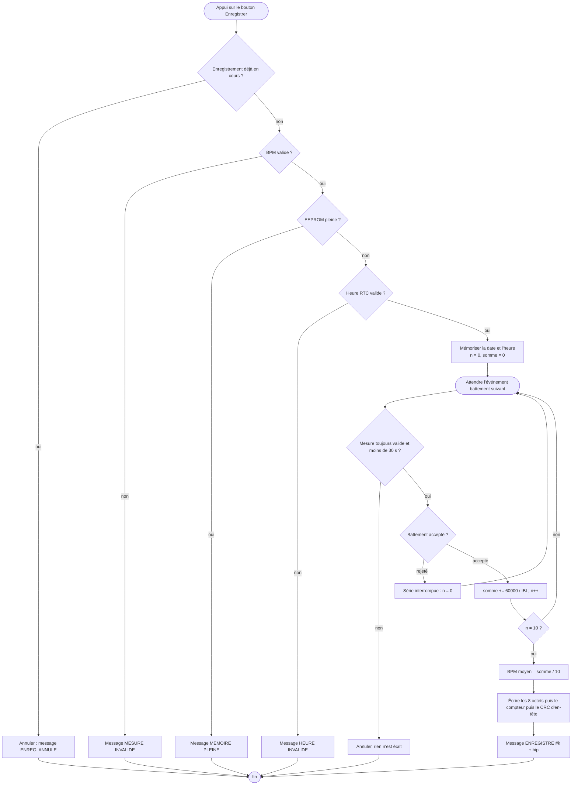

# Algorigrammes — CARDIO ECE

Conventions : **ovale** = début / fin, **rectangle** = traitement, **losange** = test.
L'algorigramme du traitement PPG (FS1) est dans [`ALGORITHME_PPG.md`](ALGORITHME_PPG.md).

## 1. Programme principal (`CardioECE.ino`)

```mermaid
flowchart TD
    START([Mise sous tension / reset]) --> S1[Mesure de pile : remplir la RAM libre d'un motif]
    S1 --> S2[Serial 115200 bauds]
    S2 --> S3[EEPROM : lire l'en-tête<br/>signature, version, CRC]
    S3 --> S3a{En-tête valide ?}
    S3a -- non, puce vierge --> S3b[Initialiser l'en-tête une seule fois]
    S3a -- CRC faux --> S3c[Reconstruire le compteur<br/>à partir des CRC des enregistrements]
    S3a -- oui --> S4
    S3b --> S4
    S3c --> S4
    S4[LED, buzzer état mémorisé, boutons, encodeur PCINT] --> S5[RTC : LECTURE seule<br/>jamais de réglage automatique]
    S5 --> S6[Menu langue mémorisée, écrans I2C 0x3C et 0x3D]
    S6 --> S7[Auto-test LED + bips non bloquant]
    S7 --> S8[Timer1 100 Hz : l'acquisition démarre]
    S8 --> L0([loop])

    L0 --> L1[Traiter TOUS les échantillons en attente dans la FIFO<br/>filtrage, détection, BPM, courbe, bip]
    L1 --> L2[Lire boutons anti-rebond + encodeur]
    L2 --> L3{Bouton enregistrer ?}
    L3 -- oui --> L3a[Recorder.toggle<br/>démarrer / refuser / annuler]
    L3 -- non --> L4
    L3a --> L4{Bouton buzzer ?}
    L4 -- oui --> L4a[Buzzer ON/OFF + mémorisation EEPROM si changement]
    L4 -- non --> L5
    L4a --> L5[Encodeur : menu ou base de temps]
    L5 --> L6{200 ms depuis la dernière lecture RTC ?}
    L6 -- oui --> L6a[Lecture rafale DS1302 + contrôle de cohérence]
    L6 -- non --> L7
    L6a --> L7[Traiter jusqu'à 4 échantillons]
    L7 --> L8{Enregistrement en cours ?}
    L8 -- oui --> L8a{Mesure invalide ou délai 30 s dépassé ?}
    L8a -- oui --> L8b[Annuler + message]
    L8a -- non --> L9
    L8 -- non --> L9
    L8b --> L9[LED : écrire SEULEMENT si la classe a changé]
    L9 --> L10[Écrans : 2 lignes de texte OU 1 bande de courbe]
    L10 --> L11[Traiter jusqu'à 4 échantillons]
    L11 --> L12[Console série : au plus 16 caractères]
    L12 --> L0
```

Durées maximales d'un tour de `loop()` (ordre de grandeur, I2C à 400 kHz) :
bande de courbe ≈ 3 ms, 2 lignes de texte ≈ 6 ms, lecture RTC ≈ 0,7 ms, ajout
EEPROM ≈ 35 ms (une fois par enregistrement). La FIFO absorbe 160 ms ; en émulation,
son remplissage maximal observé est de 3 échantillons (30 ms).

## 2. Interruption d'échantillonnage (`PPGSensor.cpp`)

## 3. Menu (`MenuManager.cpp`)

Les boutons « enregistrer » et « buzzer » sont traités **avant** le menu à chaque tour
de `loop()` : ils fonctionnent quel que soit l'écran affiché.

## 4. Enregistrement d'une mesure (`Recorder.cpp`)

