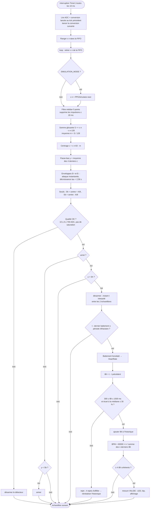

# Algorithme de traitement PPG — CARDIO ECE

Code : `PPGSensor.cpp` (acquisition), `PPGProcessor.cpp` (étapes 2 bis à 7),
`HeartRate.cpp` (étapes 8 à 10). Toutes les constantes sont dans `config.h`.
Aucune bibliothèque de détection de battement n'est utilisée.

Notations : $x[n]$ échantillon brut (0…1023), $f_s = 100$ Hz, $T_s = 10$ ms.

## 1. Acquisition analogique

* Le **Timer1** (16 bits) en mode CTC génère une interruption toutes les
  $\frac{16\,\text{MHz}}{8 \times (19999+1)} = 100$ Hz exactement (précision du quartz,
  ±50 ppm), **sans dépendre de la durée de `loop()`**.
* Dans l'interruption : lecture du registre `ADC` (résultat de la conversion lancée
  10 ms plus tôt), puis lancement immédiat de la conversion suivante. Les instants
  d'échantillonnage sont donc ceux des ticks du timer : **gigue nulle**, et pas
  d'attente active de 104 µs comme avec `analogRead()`.
* Les échantillons passent par une **FIFO** de 16 cases (160 ms de marge). Si
  `loop()` était trop lente, le compteur `perdus` (commande `STATUS`) augmenterait.
  En émulation : remplissage maximal observé **3 / 16**, **0 perdu**.
* **Horodatage** : $t[n] = n \times 10$ ms, où $n$ est le numéro d'échantillon compté par
  l'interruption. Les dates de battement sont donc liées au quartz, pas à `millis()`
  ni au moment où `loop()` traite l'échantillon.

**Pourquoi 100 Hz ?** Le pouls utile occupe 0,5-5 Hz (fondamental 0,67-3,3 Hz pour
40-200 BPM, plus quelques harmoniques). 100 Hz respecte Shannon avec une large marge
et donne une résolution temporelle de 10 ms, ramenée à ~1 ms par interpolation
(§7). Plus vite n'apporterait rien d'utile et coûterait de la RAM (fenêtre de
moyenne plus longue en échantillons).

## 2. Conversion analogique-numérique

$$ x[n] = \text{round}\left(\frac{V_{A0}}{V_{ref}} \times 1024\right),\quad V_{ref} = AV_{cc} = 5\ \text{V} \Rightarrow q = 4{,}88\ \text{mV} $$

ADC 10 bits à approximations successives, horloge $16\,\text{MHz}/128 = 125$ kHz
(dans la plage 50-200 kHz recommandée pour 10 bits), 13 cycles = 104 µs par
conversion. Le tampon d'entrée numérique de A0 est coupé (`DIDR0`) pour réduire le bruit.

## 2 bis. Filtre médian anti-impulsions

$$ x_m[n] = \text{médiane}\{x[n], x[n-1], x[n-2], x[n-3], x[n-4]\} $$

Une impulsion parasite de 1 ou 2 échantillons (≤ 20 ms : décharge électrostatique,
mauvais contact, parasite) ne peut **jamais** être la médiane de 5 valeurs : elle est
supprimée **totalement**, quelle que soit sa hauteur. À l'inverse, un front monotone
ou un pic plus large que 2 échantillons (le pic systolique en fait ≈ 10) passe sans
déformation — ce qu'un filtre moyenneur ne sait pas faire (il étalerait l'impulsion).

* Réseau de 8 comparaisons-échanges (pas de tri complet), vérifié exhaustivement.
* Retard fixe de 2 échantillons (20 ms), soustrait de l'horodatage.
* La détection de **saturation** est faite **après** le médian : une impulsion qui
  sature l'ADC pendant 10 ms n'invalide pas la mesure, une saturation durable si.
* Sans ce filtre, des impulsions de 150 ADC toutes les 2,3 s faisaient tomber le temps
  de mesure valide à 66 % (l'enveloppe « pompée » par l'impulsion masquait les
  battements suivants) ; avec le filtre : 100 % (tests `testStrongSpikes`).

## 3. Moyenne glissante (estimation de la composante continue)

$$ m[n] = \frac{1}{N}\sum_{k=0}^{N-1} x[n-k], \qquad N = 128\ (1{,}28\ \text{s}) $$

Mise à jour en $O(1)$ par **somme glissante** dans un **buffer circulaire** :

$$ S[n] = S[n-1] + x[n] - x[n-N], \qquad m[n] = S[n] / 128 = S[n] \gg 7 $$

* La somme est **entière et exacte** : aucune erreur d'arrondi ne s'accumule, même
  après des heures (test PC sur 2 h simulées).
* $N$ puissance de 2 → division par décalage.
* Au premier échantillon, le buffer est rempli avec $x[0]$ : la moyenne est juste
  immédiatement (pas de transitoire de démarrage).
* **RAM** : 128 échantillons de 10 bits rangés en 8 + 2 bits = **160 octets**
  (au lieu de 256).

**Pourquoi 1,28 s ?** La fenêtre doit couvrir au moins une période cardiaque, sinon
la moyenne « suit » le pouls et l'efface ; mais être assez courte pour suivre les
variations de lumière ou de pression du doigt.

## 4. Suppression de la composante continue

$$ c[n] = x\!\left[n - \tfrac{N}{2} + 1\right] - m[n] \qquad (\text{moyenne centrée, }`DC\_CENTERED = 1`) $$

On retranche la moyenne à l'échantillon situé **au milieu** de la fenêtre (il est déjà
dans le buffer). C'est un filtre passe-haut **à phase linéaire** :

| Fréquence | 0,1 Hz | 0,2 Hz | 0,3 Hz | 0,5 Hz | **0,59 Hz** | 0,75 Hz (45 BPM) | 1 Hz | 2 Hz | 3 Hz |
|-----------|--------|--------|--------|--------|-------------|------------------|------|------|------|
| Gain      | 0,03   | 0,10   | 0,23   | 0,55   | **0,707 (−3 dB)** | 0,96 | 1,19 | 0,88 | 1,04 |

* Les dérives lentes (lumière ambiante, respiration, pression) sont fortement atténuées ;
  une dérive **linéaire** est annulée **exactement** (propriété de la moyenne centrée).
* Contrepartie : **retard fixe de 63 échantillons (0,63 s)**. Il est soustrait de
  l'horodatage (`tMs -= 630`), donc les intervalles et le BPM ne sont pas affectés ;
  seuls le bip et la courbe sont décalés d'environ 0,7 s (médian + moyenne centrée +
  passe-bas) par rapport au pouls réel au doigt.
* Variante causale (`DC_CENTERED 0`) : $c[n] = x[n] - m[n]$, sans retard, mais une
  dérive de pente $p$ laisse un résidu $p \cdot (N-1)/2$. Mesure comparative (PC,
  dérive ±200 ADC / 8 s) : **48 %** de temps valide en causal contre **100 %** en
  centré → la moyenne centrée a été retenue.

Échelle virgule fixe : $c$ est exprimé en **1/8 de pas ADC** ($\times 2^3$) pour
garder de la résolution après soustraction.

## 5. Filtrage (passe-bas)

$$ y[n] = \frac{1}{4}\sum_{k=0}^{3} c[n-k] $$

$$ |H(f)| = \left|\frac{\sin(4\pi f/f_s)}{4\sin(\pi f/f_s)}\right| $$

| f | 1 Hz | 3 Hz | 5 Hz | 10 Hz | 15 Hz | 25 Hz | 50 Hz |
|---|------|------|------|-------|-------|-------|-------|
| gain | 0,998 | 0,978 | 0,939 | 0,769 | 0,524 | **0** | **0** |

Zéros exacts à 25 Hz et **50 Hz (secteur)**, gain > 0,94 dans la bande utile :
**les pics cardiaques ne sont pas écrasés**. Retard de groupe constant (15 ms).
Un filtre plus long lisserait le front systolique et dégraderait la datation.

## 6. Seuil adaptatif (suivi d'amplitude, gestion de la luminosité)

Enveloppes à attaque instantanée et décroissance exponentielle vers 0 :

$$ E^+[n] = \begin{cases} y[n] & \text{si } y[n] > E^+[n-1] \\ E^+[n-1]\,(1 - 2^{-8}) & \text{sinon} \end{cases} \qquad (\tau = 2^8\,T_s = 2{,}56\ \text{s}) $$

(idem pour $E^-$ avec $<$). Amplitude, centre et seuils :

$$ A = E^+ - E^-,\qquad C = \frac{E^+ + E^-}{2},\qquad S_h = C + \frac{2}{16}A,\qquad S_b = C - \frac{2}{16}A $$

* Le seuil suit automatiquement l'amplitude propre à chaque personne, à la pression
  du doigt et à l'éclairage ambiant (un signal 4× plus faible donne des seuils 4× plus
  bas) — testé de 30 à 120 pas ADC crête-à-crête.
* $\tau = 2{,}56$ s : entre deux battements (1 s à 60 BPM) l'enveloppe ne perd que
  32 % ($e^{-1/2,56} = 0{,}68$), assez lent pour rester stable, assez rapide pour
  s'adapter en quelques secondes après un mouvement.
* **Hystérésis** de $\pm A/8$ (bande de 25 % de l'amplitude) : le bruit autour du seuil
  ne peut pas produire de déclenchements multiples.
* **Qualité** : signal valide si $10 \le A \le 700$ pas ADC et pas de saturation
  ($x \le 5$ ou $\ge 1018$ marque le signal invalide pendant 0,5 s).

## 7. Détection du pic (franchissement)

Machine à deux états : **ARMÉ** quand $y < S_b$ ; **battement** quand, armé,
$y > S_h$ (franchissement **montant**). On date le **front systolique** plutôt que le
sommet : c'est la partie la plus raide de l'onde, donc la mieux définie dans le temps
(le sommet est arrondi et déformé par l'onde dicrote).

Interpolation linéaire entre les deux échantillons qui encadrent le seuil :

$$ t_b = t[n-1] + T_s \cdot \frac{S_h - y[n-1]}{y[n] - y[n-1]} $$

→ résolution ≈ 1 ms au lieu de 10 ms.

**Période réfractaire** :

$$ T_{réf} = \max\left(250\ \text{ms},\ \tfrac{1}{2}\,\text{médiane(IBI)}\right) $$

250 ms = 240 BPM maximum détectable ; la moitié de l'intervalle courant masque
l'onde dicrote (≈ 0,3-0,4 s après le pic) tout en laissant le rythme doubler si besoin.

## 8. Calcul des intervalles

$$ IBI_k = t_{b,k} - t_{b,k-1} \quad (\text{différence non signée sur 32 bits}) $$

La différence non signée reste juste au débordement du compteur (après 49,7 jours) :
testé sur PC en démarrant à $2^{32} - 10$ s.

## 9. Calcul du BPM

$$ \text{BPM} = \frac{60000 \times n}{\sum_{k=1}^{n} IBI_k},\qquad n = \min(5, \text{nombre d'IBI valides}) $$

* On moyenne les **intervalles** puis on inverse (fréquence réelle sur la fenêtre),
  plutôt que de moyenner des BPM.
* Le BPM n'est déclaré **valide** qu'après **4 intervalles cohérents consécutifs**
  (délai d'accrochage sur signal simulé : 3,97 s à 75 BPM).
* Calcul en entier ×10 (dixièmes de BPM), arrondi à l'affichage.
* Aucun `delay()` fixe : le BPM découle uniquement des instants mesurés.

## 10. Rejet des valeurs aberrantes et invalidation

| Règle | Seuil | Raison |
|-------|-------|--------|
| Plausibilité | $300 \le IBI \le 1500$ ms (40-200 BPM) | hors physiologie au repos / effort modéré |
| Cohérence | $\lvert IBI - \text{médiane}\rvert \le 30\,\%$ de la médiane (historique 8 IBI) | la médiane ignore une valeur isolée fausse ; 30 % laisse passer une variation réelle progressive |
| Battement manqué | IBI ≈ 2 × médiane → rejeté | un battement non détecté ne doit pas diviser le BPM par 2 |
| Battement parasite | IBI ≈ ½ médiane → rejeté | un pic parasite ne doit pas doubler le BPM |
| Changement de rythme réel | 4 rejets consécutifs → historique réinitialisé, nouvel accrochage | évite de rester bloqué sur un ancien rythme |
| Accrochage | moins de 3 IBI : comparaison au dernier IBI ; incohérence → on repart du plus récent | un premier intervalle faux ne bloque pas l'accrochage |
| Perte de signal | qualité insuffisante pendant 1 s → **invalide** | doigt retiré, saturation |
| Plus de battement | aucun battement accepté depuis 3 s → **invalide** | ne jamais afficher un ancien BPM indéfiniment |

Mesure invalide ⇒ `-- BPM`, toutes les LED éteintes, aucun bip, enregistrement refusé
ou annulé.

## Résultats sur signaux simulés (PC)

> **Résultats de SIMULATION** (générateur `PPGSimulator`) — **pas des mesures sur le
> capteur WPSE340.** Fichier complet : `tests/results_simulation.csv`.

| Scénario | Référence | Calculé (moyenne 20 s) | Erreur abs. | Erreur rel. | Temps valide |
|----------|-----------|-------------------------|-------------|-------------|--------------|
| Régulier | 60 BPM | 60,0 | 0,00 | 0,00 % | 100 % |
| Régulier | 80 BPM | 80,0 | 0,00 | 0,00 % | 100 % |
| Régulier | 120 BPM | 120,0 | 0,00 | 0,00 % | 100 % |
| Régulier | 45 BPM | 45,0 | 0,00 | 0,00 % | 100 % |
| Régulier | 180 BPM | 180,0 | 0,03 | 0,02 % | 100 % |
| Dérive ±200 ADC / 8 s | 72 BPM | 72,0 | 0,00 | 0,00 % | 100 % |
| Bruit ±8 ADC | 80 BPM | 80,0 | 0,01 | 0,01 % | 100 % |
| Bruit ±20 ADC | 80 BPM | 80,0 | 0,00 | 0,00 % | 100 % |
| Faible amplitude (30 ADC) | 70 BPM | 70,0 | 0,00 | 0,00 % | 100 % |
| Pics parasites 60 ADC / 2,3 s | 70 BPM | 70,0 | 0,00 | 0,00 % | 100 % |
| Impulsions 300 ADC / 0,7 s | 70 BPM | 70,0 | 0,01 | 0,01 % | 100 % |
| Impulsions 600 ADC / 0,7 s (saturation) | 70 BPM | 70,0 | 0,01 | 0,01 % | 100 % |
| Rampe 60 → 120 → 70 BPM | variable | écart max 5,7 BPM (retard du moyennage sur 5 IBI) | — | — | 100 % |
| 2 h, bruit + dérive, passage 0xFFFFFFFF | 68 BPM | écart max 0,10 | — | — | 100 % |
| Retrait du doigt | — | invalidé en 2,5 s, 0 battement accepté ensuite | — | — | — |
| Délai d'accrochage | 75 BPM | 1er BPM valide après 3,97 s | — | — | — |

Un signal simulé est « idéal » (forme constante, rythme parfaitement régulier) :
ces chiffres valident la **logique** de l'algorithme, pas sa précision réelle.
La précision réelle doit être mesurée sur le capteur (protocole HW-05 de `TESTS.md`).
