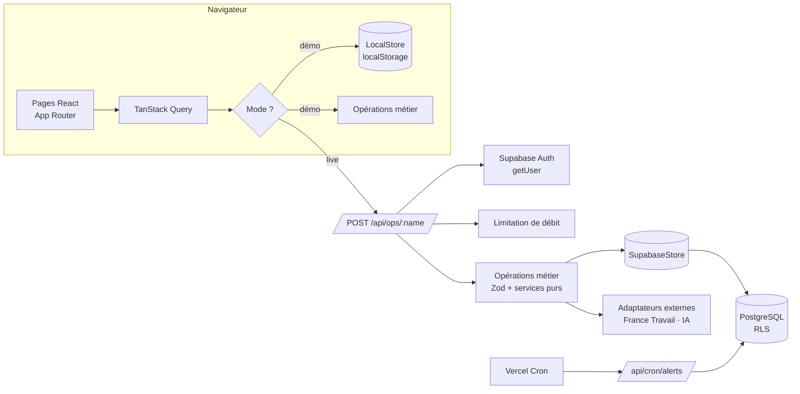

# BUDGETLY

> **Ton argent. Tes opportunités. Ton avenir.**

BUDGETLY est une plateforme d'autonomie financière pour étudiants et jeunes actifs : gestion budgétaire
multicomptes, import de relevés CSV, prévisions de trésorerie, alertes, objectifs d'épargne, plan d'action
personnalisé, découverte d'aides, bons plans, revenus complémentaires et coach financier.

Ce n'est pas une maquette : c'est une application full-stack Next.js / Supabase (PostgreSQL + RLS),
installable en PWA, testée (unitaire, intégration PostgreSQL, E2E Playwright).

---

## Sommaire
1. [Problématique](#problématique) · 2. [Fonctionnalités](#fonctionnalités) · 3. [Architecture](#architecture) ·
4. [Stack](#stack) · 5. [Installation](#installation) · 6. [Configuration](#configuration) ·
7. [Base de données](#base-de-données) · 8. [Tests](#tests) · 9. [Déploiement](#déploiement) ·
10. [Sécurité](#sécurité) · 11. [Mode démonstration](#mode-démonstration) · 12. [Limites](#limites-connues) · 13. [Roadmap](#roadmap)

## Problématique
Comment permettre aux étudiants et jeunes actifs de mieux gérer leur argent, d'anticiper leurs difficultés,
de réduire leurs dépenses, de découvrir les aides auxquelles ils ont droit et d'accéder à des revenus
complémentaires adaptés à leur situation ?

BUDGETLY répond par cinq piliers — **Comprendre, Anticiper, Économiser, Gagner, Agir** — reliés par un
moteur de plan d'action déterministe et explicable.

## Fonctionnalités
| Module | État | Détails |
|---|---|---|
| Authentification | ✅ | Inscription, connexion, vérification e-mail, mot de passe oublié/réinitialisation, Google OAuth optionnel, suppression du compte (Supabase Auth) |
| Onboarding | ✅ | 7 étapes facultatives : profil, ressources, dépenses, situation, objectifs, disponibilités, personnalisation |
| Mon argent | ✅ | Comptes (7 types), soldes calculés (comptable / en attente / disponible / programmé), archivage, transferts sans double comptage |
| Transactions | ✅ | CRUD, recherche, filtres, tri, pagination serveur, sélection groupée, catégorisation groupée + règles mémorisées, export CSV |
| Import CSV | ✅ | Encodages UTF-8/Windows-1252, `;` / `,`, dates européennes, débit/crédit séparés, doublons exacts/probables, catégorisation, import atomique, annulation |
| Tableau de bord | ✅ | 10 indicateurs définis rigoureusement, trésorerie (7 j → 12 mois + personnalisé), donut cliquable, widgets |
| Budgets | ✅ | Global et par catégorie, seuils d'alerte configurables, comparaison, duplication, répartition suggérée, historique |
| Prévisions | ✅ | Projection jour par jour, 3 scénarios, zone d'incertitude, date de découvert, hypothèses, fiabilité |
| Alertes & notifications | ✅ | 9 types, déduplication, plafond quotidien, préférences, centre de notifications, tâche planifiée |
| Abonnements | ✅ | Coût mensuel/annuel, renouvellements, rapprochement automatique avec les opérations |
| Objectifs d'épargne | ✅ | Progression, versement nécessaire, date estimée, stratégies A/B/C/D avec hypothèses |
| Plan d'action | ✅ | 3 à 5 actions/semaine, score explicable (6 facteurs), statuts, suivi des résultats réels séparé des projections |
| Coach | ✅ | Niveau 1 sans IA (10 intentions, chiffres calculés) ; niveau 2 IA facultatif avec consentement |
| Simulateur | ✅ | Scénarios « et si », comparaison, effet sur les objectifs, sauvegarde, application explicite confirmée |
| Gagner (Earn) | ✅ | Recherche, filtres, score explicable, favoris, candidatures, objectif de revenus, rentabilité, guide de déclaration ; adaptateur France Travail |
| Aides | ✅ | 15 fiches, éligibilité prudente à 3 statuts, suivi des démarches (7 états), échéances, montants reçus |
| Bons plans | ✅ | 15 offres sourcées, personnalisation selon les dépenses, comparateur, économies déclarées/vérifiées |
| Vie quotidienne | ✅ | Liste de courses budgétée, logement (seul/coloc, installation), transport, rentrée, 9 leçons + quiz |
| Analyses | ✅ | 7 graphiques, 6 indicateurs, comparaisons M-1 / 3 mois / 6 mois / N-1, export CSV et PDF (impression) |
| Gamification | ✅ | 10 défis facultatifs, série de suivi, aucune incitation à dépenser |
| Mode démonstration | ✅ | Étudiante fictive, 6 mois, 3 comptes, ≥ 100 opérations, calibrée sur un risque de −80 € |
| PWA | ✅ | Manifest, icônes, raccourcis, service worker sans données financières hors ligne, page hors ligne |

## Architecture

Une même couche d'**opérations métier** (`src/features/*/ops.ts`) s'exécute côté serveur (production) ou
dans le navigateur (démonstration). Elle ne dépend que de l'interface `DataStore`. Tous les calculs
financiers sont des **fonctions pures** testées. Détails : [docs/ARCHITECTURE.md](docs/ARCHITECTURE.md).

## Stack
Next.js 16 (App Router, Turbopack) · React 19 · TypeScript strict · Tailwind CSS 4 · composants maison de
type shadcn/ui sur Radix · Lucide · Recharts · TanStack Table & Query · React Hook Form + Zod · Supabase
(Auth + PostgreSQL + RLS) · Vitest + Testing Library · Playwright · GitHub Actions · Vercel.

## Installation
Prérequis : Node.js ≥ 20.9 (22 recommandé), npm.
```bash
cd budgetly
npm install
cp .env.example .env.local     # facultatif : sans Supabase, seul le mode démo est disponible
npm run dev                    # http://localhost:3000 → « Essayer la démonstration »
```

## Configuration
| Variable | Obligatoire | Rôle |
|---|---|---|
| `NEXT_PUBLIC_SITE_URL` | prod | URL publique (redirections e-mail/OAuth) |
| `NEXT_PUBLIC_SUPABASE_URL`, `NEXT_PUBLIC_SUPABASE_ANON_KEY` | comptes réels | Projet Supabase |
| `SUPABASE_SERVICE_ROLE_KEY` | suppression de compte, cron | **Serveur uniquement** |
| `NEXT_PUBLIC_GOOGLE_AUTH_ENABLED` | non | Affiche « Continuer avec Google » |
| `FRANCE_TRAVAIL_CLIENT_ID` / `_SECRET` | non | Active l'adaptateur d'offres d'emploi |
| `ANTHROPIC_API_KEY`, `ANTHROPIC_MODEL` | non | Active la reformulation IA du coach (consentement requis) |
| `CRON_SECRET` | cron | Protège `/api/cron/alerts` |

## Base de données
25 tables PostgreSQL, montants en **centimes `bigint`**, RLS forcée sur toutes les tables, clés étrangères
composites `(id, user_id)` empêchant tout rattachement croisé entre utilisateurs, index uniques garantissant
l'idempotence (échéances, transferts, budgets, notifications). Schéma et diagramme : [docs/DATABASE.md](docs/DATABASE.md).

## Tests
```bash
npm run lint && npm run typecheck
npm run test:unit                               # 129 tests (services, opérations, composants)
npm run db:test:start                           # PostgreSQL local jetable (affiche TEST_DATABASE_URL)
TEST_DATABASE_URL=… npm run test:integration    # 11 tests : migrations, RLS, isolation, contraintes, parcours
npm run build && npm run test:e2e               # 16 scénarios Playwright (desktop + mobile)
```
Détails et résultats : [docs/TESTING.md](docs/TESTING.md).

## Déploiement
Vercel (dossier racine `budgetly`) + Supabase. Procédure pas à pas : [docs/DEPLOYMENT.md](docs/DEPLOYMENT.md).

## Sécurité
Authentification serveur (`getUser`), RLS, filtre `user_id` systématique, validation Zod, limitation de débit,
protection CSRF par origine, en-têtes de sécurité, aucun secret côté client, journal d'audit sans montant,
neutralisation des injections CSV. Voir [docs/SECURITY.md](docs/SECURITY.md).

## Mode démonstration
`/demo` génère dans le navigateur 6 mois de données fictives pour « Léa », 21 ans. Elles ne quittent jamais
le navigateur et sont réinitialisables. Guide de soutenance (5-10 min) : [docs/DEMO.md](docs/DEMO.md).

## Limites connues
- Les fiches d'aides, bons plans et plateformes n'ont **pas pu être vérifiées en ligne** pendant le
  développement (environnement sans accès Internet) : elles sont toutes marquées « À vérifier », sans montant.
  Une revue humaine est nécessaire avant production ([docs/EXTERNAL_PROVIDERS.md](docs/EXTERNAL_PROVIDERS.md)).
- L'adaptateur France Travail suit la documentation publique mais n'a pas été testé contre l'API réelle.
- Aucun projet Supabase réel n'a été provisionné : l'authentification a été vérifiée par la compilation et
  les tests de protection de routes, pas par un parcours d'inscription complet.
- La limitation de débit est en mémoire (par instance).
- Pas de notifications push/e-mail (non configurées ; l'interface ne prétend pas en envoyer).
- Pas de connexion bancaire (couche d'abstraction prévue, voir roadmap).

## Roadmap
Voir [docs/ROADMAP.md](docs/ROADMAP.md) et l'état d'avancement dans [docs/PROGRESS.md](docs/PROGRESS.md).
