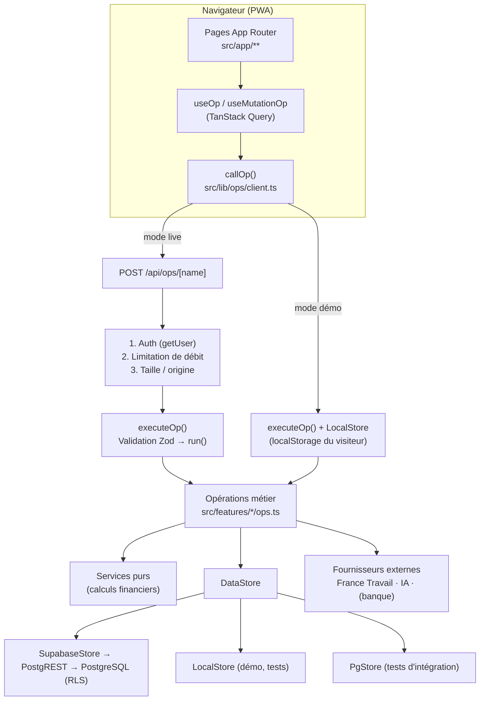

# Architecture

## Vue d'ensemble


## Couches
| Couche | Emplacement | Rôle |
|---|---|---|
| Interface | `src/app`, `src/components` | Pages, design system, graphiques. Aucun calcul financier. |
| Opérations | `src/features/*/ops.ts`, `src/lib/ops` | Cas d'usage : schéma Zod + `run(ctx, input)`. Point d'entrée unique, registre explicite. |
| Services | `src/features/**/service.ts`, `engine.ts` | Calculs purs et déterministes (soldes, prévisions, budgets, alertes, plan, coach, simulateur). |
| Accès aux données | `src/lib/data` | Interface `DataStore` + 3 implémentations. Filtre `user_id` systématique. |
| Catalogues | `src/data` | Aides, bons plans, plateformes, catégories, défis : versionnés et relus via Git. |
| Externes | `src/features/earn/providers`, `src/server/coach-ai.ts`, `src/features/banking` | Adaptateurs isolés, désactivés sans configuration. |
| Serveur | `src/server`, `src/app/api`, `src/proxy.ts` | Contexte d'exécution, limitation de débit, routes, protection des pages. |

## Pourquoi un registre d'opérations plutôt qu'une route par ressource ?
- **Une seule implémentation** de la logique métier, utilisée en production et en démonstration :
  la démo n'est pas une maquette, elle exécute exactement le même code.
- Les étapes *authentifier → autoriser → valider → exécuter → gérer les erreurs → réponse structurée*
  sont garanties à un seul endroit (`src/app/api/ops/[name]/route.ts` + `src/lib/ops/execute.ts`).
- Testabilité : les tests unitaires (LocalStore) et d'intégration (PgStore + RLS) appellent les mêmes opérations.

## Modes d'exécution
| Mode | Déclencheur | Données | Sécurité |
|---|---|---|---|
| live | session Supabase valide | PostgreSQL | RLS + filtre `user_id` + validation |
| démo | cookie `budgetly_mode=demo` (posé par `/demo`) | `localStorage` du visiteur, régénéré chaque jour | aucune donnée serveur exposée ; `/api/ops` exige toujours une session |

## Choix techniques
- **Montants en centimes entiers** (`bigint` en base, entiers JS sûrs). Divisions via `mulDiv` en `BigInt`.
- **Dates calendaires en chaînes ISO** manipulées en UTC : pas de décalage d'heure d'été.
- **Catalogues dans le code** : chaque modification d'une aide ou d'une offre passe par une revue de code
  et reste datée (`addedAt`, `verifiedAt`, `status`).
- **Pas d'ORM** : l'interface `DataStore` (CRUD filtré) suffit et reste identique pour trois moteurs.
  Les agrégations sont faites dans les services purs (volume par utilisateur faible) ; voir ROADMAP pour
  le passage à des vues SQL si nécessaire.
- **Migration mobile native** : la logique (services, opérations, catalogues) n'a aucune dépendance au DOM ;
  une application Expo pourrait réutiliser `src/features`, `src/lib` et `src/data` et appeler `/api/ops`.

## Arborescence
```
budgetly/
├─ src/app/            (public) landing & légal · (auth) · app/* pages privées · api/* routes · manifest
├─ src/components/     ui · layout · charts · forms · dashboard · landing · sources · auth
├─ src/features/       accounts · transactions · imports · finance · budgets · forecasts · alerts ·
│                      notifications · goals · subscriptions · analytics · earn · aids · deals · life ·
│                      action-plan · coach · simulations · gamification · profile · demo · banking
├─ src/lib/            money · dates · validation · data/* · ops/* · supabase/*
├─ src/data/           catalogues versionnés
├─ src/server/         contexte serveur, limitation de débit, adaptateur IA
├─ supabase/           migrations · test-shim.sql
├─ tests/              unit · integration · e2e · helpers
├─ docs/               documentation
└─ scripts/            base de test, icônes, génération SQL des catégories
```
