# Base de données

PostgreSQL (Supabase). Migrations versionnées dans `supabase/migrations/` :

| Fichier | Contenu |
|---|---|
| `20261026000100_core_schema.sql` | 25 tables, contraintes, index, triggers `updated_at`, création automatique du profil |
| `20261026000200_rls_policies.sql` | RLS forcée, politiques par propriétaire, contrôle des catégories, droits des rôles |
| `20261026000300_system_categories.sql` | 20 catégories système (générées depuis `src/data/categories.ts`) |

## Principes
- Clés primaires UUID (`gen_random_uuid()`), horodatages `created_at` / `updated_at` partout.
- **Montants** : `bigint` en centimes, jamais de flottant. Un montant de transaction est toujours `> 0` ;
  le sens est porté par `type` (`income`, `expense`, `transfer_in`, `transfer_out`).
- **Isolation** : chaque table porte `user_id → auth.users ON DELETE CASCADE`. Les références entre objets
  d'un même utilisateur utilisent des clés étrangères **composites `(id, user_id)`** : il est impossible,
  même en contournant l'application, de rattacher une opération au compte d'un autre utilisateur.
- **Idempotence** : index uniques `(recurring_id, date)` (échéances), `(transfer_group_id, type)` (transferts),
  `(user_id, month, category_id)` (budgets), `(user_id, dedup_key)` (notifications), `(user_id, week_start, key)` (actions).
- **Catalogues** (aides, bons plans, défis) : dans le code ; la base ne stocke que le suivi utilisateur
  (`user_aid_applications`, `saved_deals`, `user_achievements`).
- Les fichiers CSV ne sont jamais stockés ; `csv_imports` ne garde que des compteurs, et les opérations
  importées référencent leur import (annulation par `ON DELETE`/suppression ciblée).

## Schéma (simplifié)

```mermaid
erDiagram
  AUTH_USERS ||--|| PROFILES : "1-1"
  AUTH_USERS ||--|| USER_PREFERENCES : ""
  AUTH_USERS ||--o{ USER_CONSENTS : ""
  AUTH_USERS ||--o| AVAILABILITY_PREFERENCES : ""
  AUTH_USERS ||--o{ FINANCIAL_ACCOUNTS : ""
  FINANCIAL_ACCOUNTS ||--o{ TRANSACTIONS : "(id,user_id)"
  FINANCIAL_ACCOUNTS ||--o{ RECURRING_TRANSACTIONS : ""
  FINANCIAL_ACCOUNTS ||--o{ CSV_IMPORTS : ""
  CSV_IMPORTS ||--o{ TRANSACTIONS : "import_id"
  RECURRING_TRANSACTIONS ||--o{ TRANSACTIONS : "recurring_id"
  SUBSCRIPTIONS ||--o{ TRANSACTIONS : "subscription_id"
  TRANSACTION_CATEGORIES ||--o{ TRANSACTIONS : ""
  TRANSACTION_CATEGORIES ||--o{ BUDGETS : ""
  TRANSACTION_CATEGORIES ||--o{ CATEGORIZATION_RULES : ""
  AUTH_USERS ||--o{ SAVINGS_GOALS : ""
  SAVINGS_GOALS ||--o{ SAVINGS_ALLOCATIONS : "(id,user_id)"
  AUTH_USERS ||--o{ NOTIFICATIONS : ""
  AUTH_USERS ||--o{ ACTION_ITEMS : ""
  AUTH_USERS ||--o{ JOB_APPLICATIONS : ""
  AUTH_USERS ||--o| EARNING_TARGETS : ""
  AUTH_USERS ||--o{ USER_AID_APPLICATIONS : ""
  AUTH_USERS ||--o{ SAVED_DEALS : ""
  AUTH_USERS ||--o{ SAVINGS_RECORDS : ""
  AUTH_USERS ||--o{ FINANCIAL_SIMULATIONS : ""
  AUTH_USERS ||--o{ SHOPPING_LIST_ITEMS : ""
  AUTH_USERS ||--o{ USER_ACHIEVEMENTS : ""
  AUTH_USERS ||--o{ AUDIT_EVENTS : ""
```

## Correspondance avec la liste du cahier des charges
| Table envisagée | Choix retenu |
|---|---|
| `budget_allocations` | fusionnée dans `budgets` (un budget = mois + catégorie, `NULL` = global) |
| `forecasts` | non persistée : calculée à la demande (jamais de prévision périmée) |
| `financial_alerts` | fusionnée dans `notifications` (clé de déduplication) |
| `job_opportunities`, `job_providers` | offres récupérées à la volée chez les fournisseurs ; seules les offres suivies sont stockées (`job_applications.snapshot`) |
| `saved_jobs` | `job_applications` avec statut `saved` |
| `financial_aids`, `aid_eligibility_rules`, `deals`, `deal_providers`, `achievements` | catalogues versionnés dans `src/data` |
| `recommendations`, `action_plans` | `action_items` (semaine ISO + clé de recommandation) |
| `csv_import_rows` | non stockées (minimisation des données) |
| — (ajouts) | `earning_targets`, `savings_records`, `shopping_list_items` |

## Row Level Security
- RLS **activée et forcée** sur toutes les tables ; politiques `select/insert/update/delete` limitées à `user_id = auth.uid()`.
- `transaction_categories` : lecture des catégories système (`user_id IS NULL`) + personnelles ; écriture uniquement des siennes.
- `audit_events` : insertion et lecture par le propriétaire, aucune modification.
- Fonction `category_is_usable(category, user)` utilisée en contrainte `CHECK` : interdit d'utiliser la catégorie personnelle d'un autre.
- Le rôle `anon` n'a aucun droit sur les tables.

Les tests `tests/integration/rls.test.ts` vérifient ces garanties sur un vrai PostgreSQL.
